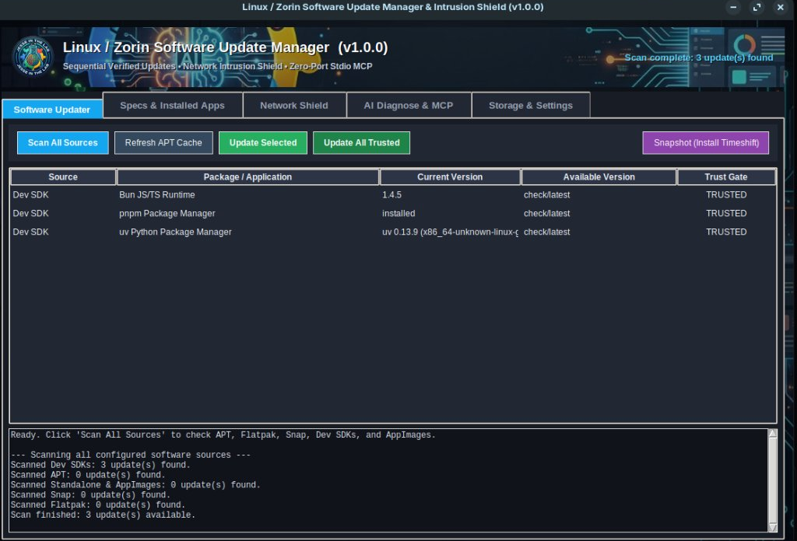

<div align="center">


# 🛡️ Universal Linux Software Update Manager & Intrusion Shield (v1.1.0)

**Universal Multi-Distro Updates (APT • DNF • Pacman • Zypper • Flatpak • Snap • AppImage) • `0.0.0.0` LAN Intrusion Shield (UFW & firewalld) • Zero-Port 4-Tier AI MCP Bridge**

[](https://buymeacoffee.com/JesseInTheLab)
[](#-easy-installation-options-choose-what-works-best-for-you)
[](https://github.com/jesusdelira7-956/SoftwareUpdateManager)

[](https://github.com/jesusdelira7-956/SoftwareUpdateManager-Linux/releases/latest)
[-success?style=flat-square)](requirements.txt)
[](https://github.com/jesusdelira7-956/SoftwareUpdateManager-Linux/actions)
[](https://zorin.com)
[](LICENSE)

<br/>



</div>

---

A portable, universal desktop application and CLI for **all major Linux distributions — Zorin OS, Ubuntu, Debian, Linux Mint, Pop!_OS, Fedora, RHEL, Nobara, Arch Linux, Manjaro, EndeavourOS, and openSUSE (Tumbleweed & Leap)** — built with **100% Python Standard Library (zero third-party `pip` runtime dependencies)**. It audits hardware specifications, scans installed software across **APT, DNF/DNF5, Pacman, Zypper, Flatpak, Snap, Dev SDKs, and AppImages**, updates packages safely, enforces a **Pre-Update Security & Trust Gate**, defends against LAN probes with **UFW & `firewalld`** auto-detection, and connects safely to AI assistants via a **4-Tier Local Agent Permission Model & Zero-Port Stdio MCP Server**.

> [!NOTE]
> **What's New in v1.1.0 (Universal Linux Release):** Full native support for **Fedora/RHEL (`dnf`/`dnf5`)**, **Arch/Manjaro (`pacman` with safe full-sync guard)**, **openSUSE (`zypper`)**, **`firewalld`** 1-click port blocking alongside `ufw`, **KDE Plasma (`kdialog`) + GNOME (`zenity`)** prompts, **`doas`/`run0`** elevation fallbacks, and portable terminal detection across all desktop environments!

---

## 🐧 Supported Linux Distributions & Environments

| Distro Family | Examples | Native Package Engine | Firewall Shield | Rollback |
| :--- | :--- | :---: | :---: | :---: |
| **Debian / Ubuntu** | Zorin OS, Ubuntu, Debian, Mint, Pop!_OS, Kali | `apt` (with lock waiter) | `ufw` | Timeshift |
| **Fedora / RHEL** | Fedora, Nobara, Rocky, AlmaLinux, CentOS | `dnf` / `dnf5` | `firewalld` | Timeshift / Snapper |
| **Arch-based** | Arch Linux, Manjaro, EndeavourOS, CachyOS | `pacman` (safe `-Syu` sync) | `ufw` / `firewalld` | Timeshift / Snapper |
| **openSUSE** | Tumbleweed (`dup`), Leap (`up`) | `zypper` | `firewalld` | Snapper |
| **Universal Formats** | Any Linux Distro (GNOME, KDE, XFCE, Hyprland, SSH) | Flatpak, Snap, Dev SDKs, AppImages | `ss` / `/proc/net/tcp` | Auto-detected |

---

## ⚡ Why Software Update Manager Instead of Raw `apt upgrade`?

| Capability | Raw `apt upgrade` / `flatpak update` | 🛡️ Software Update Manager (Linux v1.0.0) |
| :--- | :---: | :---: |
| **Unified Ecosystem** | ❌ Fragmented commands (`apt`, `flatpak`, `snap`, SDKs, AppImages) | **Single Unified Dashboard & CLI** covering all 5 software formats |
| **APT Mutex Lock Collisions** | ❌ Fails with `Could not get lock /var/lib/dpkg/lock-frontend` | **Auto Lock Waiter** (polls and waits gracefully until background updater finishes) |
| **AppImage & Standalone Updates** | ❌ Manual re-downloading | **Smart Bandwidth Caching Engine** (ETag, HTTP Redirect, GitHub Release Tag & Build-ID caching) |
| **System Rollback Safety** | ❌ None | **1-Click Pre-Update Snapshot** via native **Timeshift** or **Snapper** |
| **Local AI & Dev Port Security** | ❌ None | **Network Boundary Sentinel** (Flags `0.0.0.0` LAN exposure on Ollama/LM Studio/WebUI + 1-Click UFW Hardener) |
| **AI Assistant Integration** | ❌ None | **4-Tier Permission Gatekeeper + Zero-Port Stdio MCP Server** (Claude Desktop, Antigravity, Cursor, Copilot) |
| **Multi-Drive & Portable Storage** | ❌ Root paths only | **Interactive Secondary Storage Wizard** (Scans NVMe, secondary SSDs, `/media`, and custom folders) |
| **Least-Privilege Security** | ⚠️ Runs entire processes under `sudo` | **Privilege Split**: UI runs unprivileged; elevates *only* individual update actions via `pkexec`/`sudo` |
| **Runtime Dependencies** | Various | **Zero `pip` packages** (100% Python Standard Library + built-in Tkinter) |

---

## ☕ Support the Project

If this tool saves you time maintaining and securing your Linux and Zorin PCs, consider supporting future development:

[](https://buymeacoffee.com/JesseInTheLab)

👉 **[buymeacoffee.com/JesseInTheLab](https://buymeacoffee.com/JesseInTheLab)**

---

## 🚀 Easy Installation Options (Choose What Works Best For You)

### 🥇 Option 1: 1-Click Desktop Installer (`install.sh`)
> **Best for desktop users wanting a launcher in the Zorin / GNOME App Menu and Desktop icon.**

Clone the repository and run the installer:
```bash
git clone https://github.com/jesusdelira7-956/SoftwareUpdateManager-Linux.git
cd SoftwareUpdateManager-Linux
chmod +x install.sh
./install.sh
```

#### What `install.sh` does automatically:
- Checks if `python3` and `python3-tk` are available (prompts to install `python3-tk` if GUI mode is desired).
- Installs an application launcher (`software-update-manager.desktop`) into `~/.local/share/applications/`.
- Places a launcher icon directly onto your **Desktop**.
- Creates a user symlink in `~/.local/bin/software-update-manager` for fast terminal access (`software-update-manager --cli`).

---

### 🥈 Option 2: Portable / Zero-Install Run
> **Best for instant use or running from a secondary SSD / USB drive. Requires NO system installation!**

```bash
# Choose GUI or CLI mode interactively:
python3 update_manager.py

# Launch Desktop GUI directly:
python3 update_manager.py --gui

# Launch Interactive CLI directly:
python3 update_manager.py --cli
```

---

### 🥉 Option 3: Headless & Automation Flags (Cron / CI / Scripts)
> **Best for headless servers, SSH sessions, or unattended maintenance.**

```bash
# Quick exit-code check (0 = up to date, 100 = updates available):
python3 update_manager.py --check

# Unattended sequential upgrade of all trusted packages:
python3 update_manager.py --upgrade-all --yes

# Network Intrusion audit of exposed 0.0.0.0 listening ports:
python3 update_manager.py --audit-network

# Export detailed computer specs & storage audit:
python3 update_manager.py --specs
```

---

### 🤖 Option 4: Zero-Port Stdio MCP Server (AI Agent Integration)
> **Best for connecting to Claude Desktop, Antigravity IDE, Cursor, or Microsoft Copilot.**

```bash
python3 update_manager.py --mcp
```

Add this snippet to your AI client's MCP configuration (`claude_desktop_config.json` or `mcp_config.json`):
```json
{
  "mcpServers": {
    "linux-software-update-manager": {
      "command": "python3",
      "args": ["/path/to/SoftwareUpdateManager-Linux/update_manager.py", "--mcp"]
    }
  }
}
```

---

## ✨ Key Features

- **🎨 Dual-Mode Interface (Desktop GUI & Interactive CLI)**:
  - **Tkinter Visual Dashboard**: Sleek Zorin dark-mode design with KPI cards, live log stream, multi-drive selector, and responsive layout.
  - **Interactive Terminal Menu**: ANSI-colorized CLI with formatted tables, progress feedback, and keyboard shortcuts.
  - **Automated Fallback**: Gracefully detects headless SSH sessions or missing GUI libraries and switches to CLI automatically.
- **🛡️ Zero-Dependency Network Boundary Sentinel & Intrusion Shield (`core/network_auditor.py`)**:
  - Uses native Linux `ss -tlnp` (with `/proc/net/tcp` standard library fallback) to scan active listening ports across local AI engines (Ollama `11434`, LM Studio `1234`, Open WebUI `8081`, ComfyUI `8188`, SwarmUI `7801`, dev ports `3000-9000`).
  - **Exposure Classification**: Identifies whether ports are safely isolated to `127.0.0.1` (Localhost) or dangerously open on `0.0.0.0` / `::` (LAN-exposed).
  - **1-Click UFW Firewall Hardener**: Blocks external incoming probes on developer ports while preserving localhost traffic.
- **📦 Multi-Format Sequential Package Engine (`core/package_engine.py`)**:
  - **APT Engine**: Updates Debian/Ubuntu repositories sequentially with automatic `/var/lib/dpkg/lock-frontend` polling.
  - **Flatpak & Snap Engines**: Audits user and system-level runtimes and sandboxed applications.
  - **Developer SDKs**: Tracks and updates `rustup`, `uv`, `bun`, `pnpm`, and `flutter` using native CLI calls and remote semver comparison.
- **⚡ Smart Bandwidth Caching AppImage Engine (`core/appimage_engine.py`)**:
  - Tracks standalone AppImages (Obsidian, Joplin, LM Studio, AnythingLLM, Telegram, balenaEtcher, and Docker Desktop).
  - Uses **ETag, HTTP 302 Redirect Header, GitHub Release Tag, and Build-ID caching** stored in `~/.config/software-update-manager/cache/` to eliminate redundant gigabytes of downloads.
- **🛡️ Pre-Update Security & Trust Gate (`core/security_auditor.py`)**:
  - Validates SHA-256 binary checksums before executing downloaded installers.
  - Cross-references package names against `pup_blocklist.json` to block adware, bundleware, and untrusted repositories.
  - Sanitizes package metadata and terminal arguments against Indirect Prompt Injection (IPI).
- **💾 1-Click System Rollback Snapshots (`core/rollback_manager.py`)**:
  - Automatically detects **Timeshift** or **Snapper** and creates a safety snapshot before any batch updates are applied.
- **💻 Hardware Specs & Secondary Storage Wizard (`core/specs_collector.py` & `core/config_manager.py`)**:
  - Scans CPU, GPU, RAM, Kernel version, OS build, and storage drives without external libraries.
  - Interactive setup wizard scans `/proc/mounts` to detect secondary NVMe, SSD, or portable drives and ask if apps are stored in custom locations.
- **🤖 4-Tier AI Agent Permission Model & Universal Diagnostic Bridge (`agent_bridge.py`)**:
  - **Universal Diagnostic Bundle**: Generates an injection-hardened system summary for 1-click clipboard pasting into web AI assistants.
  - **Zero-Port Stdio MCP Server**: Communicates via `sys.stdin`/`sys.stdout` JSON-RPC. **Zero listening TCP ports** — immune to remote network scans.

---

## 📂 Repository Structure

```text
SoftwareUpdateManager-Linux/
├── .github/
│   ├── ISSUE_TEMPLATE/
│   │   ├── bug_report.md          # Structured Linux bug reporting form
│   │   └── feature_request.md     # Architectural feature proposal form
│   ├── workflows/
│   │   └── ci-validate.yml        # GitHub Actions zero-dependency validation workflow
│   ├── FUNDING.yml                # Native GitHub "Sponsor" button config
│   └── pull_request_template.md   # PR quality & testing checklist
├── assets/                        # Application icons, emblems, and visual banners
│   ├── circle_logo.png            # Standard circular emblem
│   ├── circle_logo_large.png      # High-resolution branding emblem
│   ├── app_icon.png               # Desktop application icon
│   └── banner_bg.png              # Dark-mode dashboard header background
├── config/
│   ├── providers.json             # Declarative standalone AppImage and binary feeds
│   └── pup_blocklist.json         # Known PUP, adware, and high-risk definitions
├── core/
│   ├── ai_launcher.py             # Web AI shortcuts & local desktop AI detection
│   ├── appimage_engine.py         # Smart bandwidth-caching AppImage update engine
│   ├── config_manager.py          # Dynamic secondary storage wizard & XDG config
│   ├── network_auditor.py         # Network Boundary Sentinel & 0.0.0.0 socket auditor
│   ├── package_engine.py          # APT, Flatpak, Snap, and Dev SDK update handlers
│   ├── privilege_helper.py        # Least-privilege pkexec/sudo elevation & tk installer
│   ├── rollback_manager.py        # Timeshift and Snapper 1-click snapshot integration
│   ├── security_auditor.py        # Pre-Update Security Trust Gate & IPI sanitizer
│   └── specs_collector.py         # Hardware specifications & storage inventory
├── ui/
│   ├── cli_app.py                 # ANSI-colorized interactive terminal interface
│   └── gui_app.py                 # Zorin dark-mode Tkinter visual dashboard
├── agent_bridge.py                # Zero-port 4-Tier Stdio MCP Server & AI diagnostic bridge
├── update_manager.py              # Unified entrypoint (CLI, GUI, Headless, MCP)
├── install.sh                     # 1-click Desktop & CLI symlink installer
├── AGENT_SAFETY.md                # AI Agent integration, least privilege & safety rules
├── CHANGELOG.md                   # Release history & version ledger
├── CODE_OF_CONDUCT.md             # Community standards & behavioral pledge
├── CONTRIBUTING.md                # Contributor guide & zero-pip architecture rules
├── HELP_AND_USER_GUIDE.md         # Comprehensive user manual & troubleshooting
├── SECURITY.md                    # Vulnerability reporting & supported versions policy
├── requirements.txt               # Zero external dependencies (100% Python Stdlib)
├── LICENSE                        # MIT License
└── README.md                      # Documentation & Quick Start Guide
```

---

## 📜 License & Privacy Notice

Released under the [MIT License](LICENSE). Free to use, modify, and share across personal and enterprise computers.

> **Privacy & Anti-Solicitation Notice:** Automated scraping of maintainer contact details, unsolicited third-party "trust index" or badge-farming outreach, and commercial email solicitations regarding this repository are unwelcome. All legitimate inquiries and bug reports belong exclusively in **GitHub Issues**. Please respect developer privacy.
